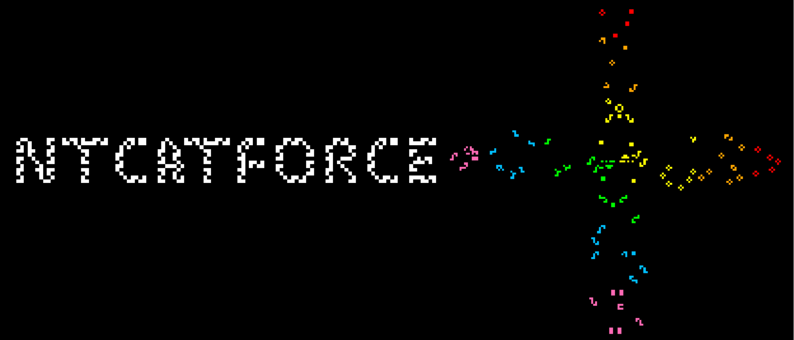

<p align="center">
  <br>
  <sub>font by Aleph, second conduit from left by r2int, fourth conduit from left by AbhpzTa, second conduit from bottom by synperiplanar, all else by me</sub>
</p>

# ntCatForce+

**CatForce** by Michael Simkin but modified to run on INT (and MAP) rules. The original CatForce was not multithreaded and was difficult to use for more complex tasks. Along with adding INT support, this version adds multithreading, some other speedups, a HTML page for editing infiles, mvr's symmetry support, and a few other useful tweaks. The vast vast majority of this project was coded with AI, so expect a lot of bugs and weirdly verbose output logs. Sorry.

Main additions: per-rule compiled SIMD kernels, Apple-silicon support, bait objects, search/exclude areas,
`also-required` cells, unique-outcome output, lightcone pruning, contact filter, pause/resume, and an
in-browser `.in` file generator. Every input keyword is documented in [CatForce/README.md](CatForce/README.md);
development notes and measurements are in [HANDOFF.md](HANDOFF.md).

| Path | What it is |
|---|---|
| `CatForce/` | Source. `cd CatForce && make`, then `./CatForce file.in` |
| `CatForce/README.md` | Input-file reference (every keyword) |
| `generator/catforce_in_generator.html` | `.in` file generator; open in a browser |
| `generator/src/` | Generator sources; `python3 generator/src/build.py` rebuilds the page (both copies) |
| `tests/` | Regression suite (checks a build against recorded results) |
| `diag/` | Python helpers to decode and simulate RLE results |
| `user_files/` | Example search files |

## Quick check

```
cd CatForce && make
./CatForce ../user_files/highlife2.txt --max-time 12     # ~1 s, 7 results
bash ../tests/suite.sh ./CatForce check                   # ends with "all match tests/base.txt"
```
